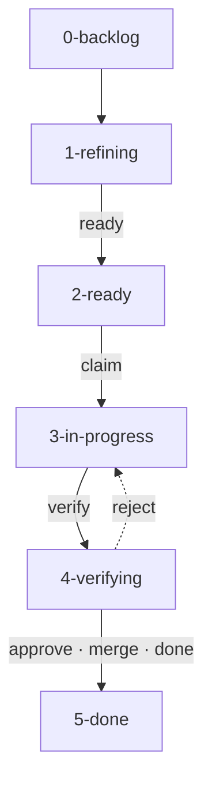

# Kahnban — Portable Agentic Kanban Workflow Engine & Software Factory

**Status:** Engine `1.4.0` (`kahnban --version`). Gated Kanban pipeline from approved spec to merged code: proof-checked verify, review and merge-queue gates, an unattended factory loop (`kahnban run`), and a role guard for agent workers. CI runs the suite on Windows and Linux, Python 3.10–3.13.

Kahnban is a zero-dependency, model-agnostic Kanban system and software factory conductor for AI coding workflows. It provides machine-enforced gates, strict transparency into in-flight agent tasks, prevents workspace collisions across concurrent LLM sessions, and maintains a single source of truth backed by Git storage.

## How It Works

A ticket's column is its status: each column is a folder under `plans/tickets/`, and every move between columns is one commit on the default branch. A ticket moves forward through gates: commands that check the ticket and refuse the move if anything is missing:



| Stage | Who works it | What happens there | Leaves through |
| :--- | :--- | :--- | :--- |
| [0-backlog, 1-refining](docs/how-it-works.md#backlog-and-refining) | a human or the spec-analyst | Ideas, plans and specs become tickets. Refining adds acceptance criteria that each name a test, a blast radius of files, and validation commands. | `ready` |
| [2-ready](docs/how-it-works.md#ready) | nobody yet | The ticket's contract is frozen, and it waits for a coder and a free blast radius. | `claim` |
| [3-in-progress](docs/how-it-works.md#in-progress) | the coder | Test-first work in the ticket's own worktree, committed on `ticket/<ID>`. | `verify` |
| [4-verifying](docs/how-it-works.md#verifying) | the qa-reviewer, then the integrator | A different reviewer approves or rejects, then the merge queue tests the merged result. | `approve`, `merge`, `done` (or `reject`) |
| [5-done](docs/how-it-works.md#done) | — | A learnings reflection, then `cleanup` removes the worktree and branch. | — |

A gate can only be bypassed on purpose: `kahnban move` and the `--force` overrides on `claim` and `verify` each need a `--reason`, which is written to the ticket's Log.

Each stage links to [How Kahnban works](docs/how-it-works.md), which goes one level down (the checks inside each gate) and then into the deeper flows: the factory loop, the merge queue, the architecture and the learnings loop.

## Quick Start

```powershell
py -3 -m pip install -e .        # install the engine (editable)
py -3 -m pytest -q               # drives real git repos, ~5 min
kahnban --version
```

Adopt it in a repository with agentic scaffolding and skills:

```powershell
cd C:\github\<your-repo>
kahnban init --prefix KB --agentic    # scaffolds board, .agents/, and ./learnings/
kahnban skills install                # distributes skills to detected harnesses (.claude, .gemini, .cursor, .vscode, .hermes)
```

Get work onto the board from whatever you have:

```powershell
kahnban capture "Try a warm cache"              # ideation
kahnban ingest plans/PLAN.md --dry-run          # preview an AI-generated plan
kahnban ingest plans/PLAN.md --ready            # ingest it, then attempt the gate
kahnban ingest --per-file specs/*.md            # one ticket per feature spec
kahnban new "Add the targeting panel" --problem-file spec.txt
```

Run a ticket through the 5-stage lifecycle:

```powershell
kahnban ready KB-001                     # gates requirements, acceptance checkboxes, blast radius
kahnban next                             # situational dispatcher: prints exact role, worktree, prompt

kahnban claim KB-001 --owner agent-a --worktree
# ... execute in isolated worktree .worktrees\KB-001 on branch ticket/KB-001 ...

kahnban verify KB-001                    # executes Dual-Tier QA: Tier 1 Feature Tests && Tier 2 Regression Tests
kahnban approve KB-001 --reviewer qa-b   # a reviewer other than the owner signs off the verified tip
# or: kahnban reject KB-001 --reviewer qa-b -m "..."   (back to in-progress, boxes unticked)
kahnban merge KB-001                     # merge queue: test main+branch, land only if green

kahnban done KB-001                      # marks done and triggers learnings reflection prompt
# ... capture friction or mistakes into self-improving queue ...
kahnban learnings capture --title "Race condition in cache" --ticket KB-001 --location "cache.py:42"
kahnban cleanup KB-001                   # prunes worktree & local ticket branch
```

`kahnban lint` exits 0 clean, 1 on violations, 2 on a config or I/O error — wire it into your CI or pre-commit hook as a gate.

---

## Autonomous Factory Mode (`/factory-mode`) & `kahnban next`

For autonomous agents operating across **Claude Code**, **ChatGPT**, **Antigravity**, **VSCode**, and **Hermes**, Kahnban provides situational dispatching:

```powershell
kahnban next            # human-readable briefing with exact commands & prompts
kahnban next --json     # machine-readable HandoffBaton for autonomous subagents
```

When invoked, the agent systematically drives work through 5 strict stages:
1. **Intake & Refinement**: `/grill-with-docs` $\rightarrow$ `/to-spec` $\rightarrow$ `/to-tickets` $\rightarrow$ `kahnban ready` $\rightarrow$ triggers `post-ready` hook
2. **Claim & Worktree Isolation**: `kahnban claim <ID> --worktree` $\rightarrow$ emits `.agents/HANDOFF.json` into worktree $\rightarrow$ triggers `post-claim` hook
3. **Execution Rigor**: Coder Agent reads `HANDOFF.json`, adheres strictly to declared blast radius, and applies PSTACK principles + `/tdd`
4. **Dual-Tier QA & Verification**: `kahnban verify <ID>` runs the feature tests, each criterion's test and the regression tests, plus the proof check under `require_proof` ([every check, in order](docs/how-it-works.md#in-progress))
5. **Review Gate & Closure**:
   - QA Reviewer Agent audits tests and diff. If defective: `kahnban reject <ID> --reviewer <name> -m "..."` moves it back to `3-in-progress` with the reasons in its Log.
   - If sound: `kahnban approve <ID> --reviewer <name>` (never the owner) $\rightarrow$ integrator runs `kahnban merge <ID>` $\rightarrow$ `kahnban done` $\rightarrow$ triggers `post-done` hook $\rightarrow$ `/reflect` $\rightarrow$ `kahnban cleanup`

---

## Dual-Tier QA Testing Syntax

Tickets can declare separate feature and regression test commands in `## Validation`:

```markdown
## Validation
### Feature Tests
```bash
pytest tests/features/test_token_revocation.py -v
```

### Regression Tests
```bash
pytest tests/ -q
```
```

If the regression block is omitted, Kahnban automatically falls back to `validation_command` / `regression_command` in `plans/board.config.json`.

Each line of a block is one command, run on its own; the first non-zero exit fails the block (a trailing `\` or backtick continues a line). Shell state such as `cd` does not carry between lines.

Each acceptance criterion names the test that proves it, and `verify` ticks the box only when that test exits 0:

```markdown
## Acceptance criteria
- [ ] Revoked tokens are rejected (test: `pytest tests/features/test_token_revocation.py::test_rejects_revoked`)
- [ ] Error copy matches the design
```

A criterion without a test is left for a reviewer to tick. Under `require_proof` the ready gate refuses one unless the ticket is `validation_class: visual-deferred`.

### What `verify` refuses

| Gate | Refuses when |
| :--- | :--- |
| Frozen contract | `## Acceptance criteria`, `## Blast radius` or `## Validation` changed after `ready` (stored as `contract_hash`; ticking boxes does not count) |
| Clean tip | the worktree has uncommitted or untracked changes, or is not at the tip of `ticket/<ID>` |
| Scope | the branch changes any path outside `## Blast radius`, tests and `.github/` included |
| Fail fast | any line of a validation block, or any criterion test, exits non-zero |
| Proof (`require_proof`) | the branch changes no source files, a criterion names no test, or the feature tests still pass with the source reverted to the merge-base |

### What `approve`, `merge` and `done` refuse

| Gate | Refuses when |
| :--- | :--- |
| Review (`require_review`) | `approve` by the ticket's owner, or after the branch moved since verify; `merge` and `done` without an approval of the current branch tip |
| Rejection | `reject` always moves the ticket back to `3-in-progress`, unticks every box, and clears the verify, approval and integration records |
| Merge queue (`require_integration`) | `merge` lands nothing if the branch conflicts with the default branch, or if the feature or regression tests fail on the merged result; `done` refuses a ticket that did not land through `kahnban merge` |

`merge` holds the board lock while its tests run, so merges happen one at a time and each is tested against everything merged before it. A fresh `verify` clears any earlier approval.

`kahnban init` writes `"require_proof"`, `"require_review"` and `"require_integration"` as `true`; boards without those keys keep the old behaviour. Files matching `test_patterns` (defaults: `tests/`, `test_*`, `*_test.*`, `*.spec.*`, …) count as tests, everything else as source.

---

## From an Idea to Ready Tickets (specs)

The one human gate is approving the spec. Everything after it runs on checks.

```powershell
# /grill-with-docs interviews you in rounds and drafts the spec
kahnban spec new "Bounds checking"                    # .agents/specs/SPEC-001-bounds-checking.md (draft)
kahnban spec approve SPEC-001 --by tim                # you: freezes '## Requirements' (R1, R2, ...)
kahnban ingest .agents/specs/SPEC-001-bounds-checking.md --ready   # its '## Tickets' items -> tickets
kahnban spec coverage SPEC-001                        # exit 1 until every requirement has a ticket
```

A spec lists one observable outcome per line under `## Requirements` (`- R1: ...`). Each item under `## Tickets` names the files it touches and the requirements it satisfies (`Covers: R1`). Ingest gives every ticket `spec: SPEC-001` and `covers: [R1]`, and `Blocked on: none` stays empty.

| Gate | Refuses when |
| :--- | :--- |
| `require_spec` (opt-in) | `ready` for a ticket with no `spec:`, a spec that isn't approved or whose requirements changed since approval, or a `covers:` id the spec doesn't have |
| `max_blast_radius_files` (`init` writes 3) | `ready` for a ticket listing more paths than that, or naming a directory instead of files |
| `require_proof` | `ready` for a ticket whose blast radius names no test file |
| BL18 (lint) | a ticket citing a missing spec or requirement, or an approved spec edited since approval; an uncovered requirement is a warning |

`kahnban spec approve` is blocked for every factory role by `kahnban guard`: only a human approves intent.

---

## Running the Factory (`kahnban run`)

`kahnban run` is the loop: it asks the dispatcher for the next action, runs every gate itself (`ready`, `claim`, `verify`, `merge`, `done`), and starts a worker only for the judgment work: refining, implementing, reviewing, and, once per run when a learning has recurred (`occurrences >= 2`) or is critical, curating it into a fix ticket before new work is claimed. A worker cannot skip a gate or report a success it did not earn.

[The factory loop](docs/how-it-works.md#the-factory-loop) shows the loop and the order in which the dispatcher picks work.

```powershell
kahnban skills install --harness claude   # or gemini, cursor, all: agent files + guard hook; commit .claude/ (.gemini/, .cursor/)
kahnban skills check                      # exit 1 if skills, roles, agent files or the lock disagree
kahnban skills lock                       # pin skills and .kahnban/hooks by SHA-256 (install does this too)
kahnban run --max-steps 20                # until the board is idle or every open ticket is parked
```

Workers are commands in `plans/board.config.json`. The prompt arrives on stdin, `{role}` expands to `coder`, `qa-reviewer`, `spec-analyst` or `curator`, and `KAHNBAN_ROLE`, `KAHNBAN_TICKET`, `KAHNBAN_PROJECT_ROOT` and `KAHNBAN_WORKTREE` are set:

```json
"workers": {"default": "claude -p --agent kahnban-{role} --permission-mode acceptEdits"},
"worker_timeout_sec": 3600,
"max_attempts": 3,
"autonomy": "unattended",
"max_stop_nudges": 2,
"strict_hooks": true,
"require_signed_approvals": true,
"lease_minutes": 30,
"allowed_commands": ["pytest", "python -m pytest"]
```

Choose the permission mode deliberately: a coder needs to run tests and `git commit`, and `--permission-mode` / `--allowedTools` decide what it may do without asking.

| Mechanism | What it does |
| :--- | :--- |
| Leases | `claim` (and `kahnban lease`) record who is working a ticket; `next` skips tickets with a live lease, and `run` renews the lease while its worker runs. An expired lease can be taken over, and the takeover is logged. |
| Escalation | A ticket that comes back to the same action more than `max_attempts` times (counted across runs in `.artifacts/attempts.json`, reset by `unblock`, `confirm` or escalation) is escalated: `blocked_on: human: <reason>`, the `on-escalate` hook fires, and `next` skips it until `kahnban unblock <ID> --reason "..."`. Workers can run `kahnban escalate` themselves instead of guessing. |
| Trust | `.agents/skills.lock.json` pins every skill and lifecycle hook by SHA-256, and `skills check` fails when one changes without a re-lock, so an unattended run does not execute edited instructions. With `"require_signed_approvals": true`, `approve` stores an HMAC of the ticket, tip and reviewer (key: `KAHNBAN_SIGNING_KEY`, else a per-user file under `%APPDATA%\kahnban\keys` or `~/.local/state/kahnban/keys`), and `merge` and `done` refuse a hand-edited `reviewer:`. Workers never sign: `run` strips the key from their environment, their `approve` records no signature, the runner countersigns, and the guard refuses their reads of the key. New boards from `kahnban init` turn this on. It stops forged board edits, not a worker running as the same OS user; use another account or a container for that. |
| Autonomy | `"autonomy": "unattended"` (default) lets the runner take every gate. `"attended"` parks a ticket before each gate in `human_gates` (`merge` by default, optionally `ready`) with `blocked_on: human: ...`; a person reviews it and runs `kahnban confirm <ID>`. The `merge` confirmation is tied to the branch tip, so new commits need a new one, and no worker may run `confirm`. The `ready` confirmation covers the contract a person saw: editing the criteria, blast radius or validation asks again. Once confirmed, the runner takes the gate itself; `KAHNBAN_ROLE` is what stops a worker taking it, and a person running `kahnban merge` or `kahnban done` by hand is trusted. |
| Timeouts | A worker that outlives `worker_timeout_sec` is killed along with every process it started, and nothing else. |
| Role manifest | `templates/roles.json` defines each role once: the `kahnban` commands it may run, the files it may edit, the skills its agent preloads, and what it is told to do. The guard, the prompts `run` and `next` hand out, the handoff baton and the native agent files (`.claude/agents/`, `.gemini/agents/`, `.cursor/agents/`) are all rendered from it. Gemini CLI and Cursor have no `skills:` preload or tool allow-list, so their agent files tell the agent which skills to read first and the same guard hook (`BeforeTool`/`AfterAgent`, `beforeShellExecution`/`preToolUse`/`stop`) enforces the role. `kahnban skills check` fails when a skill or role names a missing skill, a skill no agent may invoke, or a command its role can't run, and when a project's agent files or harness skill copies have drifted. |
| `kahnban guard` | A PreToolUse hook (installed by `skills install --harness claude`) that is a no-op unless `KAHNBAN_ROLE` is set. Inside a worker it blocks edits outside the role's remit (a coder: its worktree and blast radius; a reviewer: nothing) and blocks override flags, `git merge/push/rebase/reset --hard`, and `kahnban` commands outside the role. The CLI and the MCP server apply the same role table themselves whenever `KAHNBAN_ROLE` is set, so a harness without hooks is covered too. `kahnban guard --stop`, installed as a Stop hook, pushes back up to `max_stop_nudges` times (default 2) when a worker tries to stop before its role is done, then leaves the decision to the runner's own check after the worker exits: a coder's work committed and inside the blast radius, a reviewer's approve or reject, a spec analyst's ticket passing `ready`, the curator leaving no recurring learning without a fix ticket (escalating always counts). Shell commands are read as a shell reads them, including `bash -c`, `$(...)`, git's global options, and writes by redirection, `tee`, `sed -i`, `cp` and `rm`, which are held to the same blast radius as an edit. It's a tripwire against mistakes, not a sandbox. |
| `allowed_commands` | When set, `ready`, `verify` and `merge` refuse any ticket-supplied validation or criterion command that doesn't start with an allowed prefix. Tickets can come from ingested AI plans, and their commands run with your privileges. |
| Metrics | `plans/status.json` → `metrics`: verify attempts, rejections, escalations and cycle hours per ticket, read from its Log, plus first-pass yield and median cycle time for done work. |
| Stale claims | Lint warning BL19 when an in-progress ticket has not moved for `stale_after_days` (`init` writes 3). |

---

## Continuous Learning Subsystem (`./learnings/`)

Kahnban incorporates a pattern-aggregating self-improvement queue based on continuous learning principles. Instead of logging one-off noise, it clusters environmental recurrences, escalates severity, and tracks affected file locations. [The learnings loop](docs/how-it-works.md#the-learnings-loop) shows the flow from capture to promotion.

- **Capture & Cluster**:
  ```powershell
  kahnban learnings capture --title "Direct non-atomic file writes" --ticket KB-002 --location "status.py:45"
  ```
  If a matching pattern or file path already exists, Kahnban automatically augments occurrences (`occurrences: 2`), escalates severity, and appends the new occurrence row without creating duplicate files.
- **Inspect**:
  ```powershell
  kahnban learnings list                 # view pending patterns
  kahnban learnings show LRN-0001        # view detailed history and evidence table
  ```
- **Promote & Institutionalize**:
  Drain learnings into structural defenses via the 4-tier escalation ladder:
  - **Level 1 — Architecture**: Make the mistake physically impossible (boundaries, deprecations, SSOT).
  - **Level 2 — Linters & Types**: Static analysis, type invariants, or AST rules rejecting the pattern.
  - **Level 3 — Automated Tests**: Regression test fixtures in `tests/` asserting correct behavior.
  - **Level 4 — Documentation & Rules**: Update `AGENTS.md` / rules when static barriers are impossible.

  ```powershell
  kahnban learnings promote LRN-0001 --level 2 --artifact tools/lint_atomic_writes.py --notes "AST rule rejecting non-atomic writes"
  ```
  Promoted records are archived cleanly to `learnings/archive/`.

---

## Documentation

- **[docs/how-it-works.md](docs/how-it-works.md)** — each stage and its gate, the factory loop, the merge queue, the architecture and the learnings loop, as diagrams
- **[adapters/AGENTS.md](adapters/AGENTS.md)** — universal agent working agreement to copy into adopter repos
- **[adapters/README.md](adapters/README.md)** — adopting Kahnban in an existing repository
- **[adapters/MCP.md](adapters/MCP.md)** — MCP client registration per IDE (Cursor, Claude, VS Code, Hermes)
- **[adapters/PLAN-INGESTION.md](adapters/PLAN-INGESTION.md)** — entry points: ideation, plan documents, or feature specs
- **[plan.md](plan.md)** — complete engine specification (architecture, contracts, roadmap)
- **[IMPLEMENTATION_STATUS.md](IMPLEMENTATION_STATUS.md)** — implementation details and invariant guarantees

---

## Key Principles

0. **One Conduit, Many Entry Points** — ideation, AI-generated plans, feature specs, or single tickets all converge on identical drafts and gates; ingestion is idempotent and never fabricates readiness.
1. **Folders Are Status** — columns are physical directories (`0-backlog` … `5-done`); board state commits to the default branch immediately.
2. **Universal Client** — agents use MCP or the CLI; both call the same in-process core, so there is exactly one implementation of every transition.
3. **Worktree Isolation** — code changes live in `.worktrees/<ID>` on `ticket/<ID>`; board state never lands on a ticket branch (Rule D2).
4. **Enforced Gates** — the tooling refuses invalid transitions; refinement is enforced at `2-ready`.
5. **Proven Verification** — `kahnban verify` runs the committed tip's feature, criterion and regression tests line by line, and under `require_proof` shows the feature tests fail without the change (Rule D4).
6. **Domain Isolation** — claim-time blast-radius overlap refusal plus verify-time diff containment prevent merge conflicts (Rules D7, BL16).
7. **Pattern-Aggregating Feedback** — friction and mistakes are captured into `./learnings/`, clustered into recurrence records, and promoted into structural defenses.
8. **Relay Baton Handoffs** — every move rewrites the ticket's baton for whoever acts next (`.agents/handoffs/<ID>.json`, mirrored into the worktree as `.agents/HANDOFF.json`), with the event that caused it and the last verify results. Every move runs the `pre-transition` hook, which can veto it by exiting 2, and the `post-transition` hook; `claim` asks the veto before it creates a worktree, so a vetoed claim leaves nothing behind; with `strict_hooks` (on for new boards) a veto hook that crashes or times out also refuses the move; every refusal, including the guard's, runs `on-refusal`; the named hooks (`post-ready`, `post-claim`, `post-verify`, `post-done`, `on-escalate`) still fire. Hooks live in `.kahnban/hooks/` and get the event as JSON on stdin.

---

## Module Map

Zero runtime dependencies. Test and line counts are left out on purpose: run `py -3 -m pytest -q` for the current ones.

| Module | Owns |
| :--- | :--- |
| `core` | config, the single `transition()` writer, every gate (ready, claim, verify, approve, reject, merge, done), leases, escalation |
| `specs` | spec drafts, the approval gate, requirement coverage |
| `runner` | `kahnban run`: the factory loop and its workers |
| `roles` | the role manifest (`templates/roles.json`) and everything rendered from it: role prompts, agent files, the guard's tables |
| `guard` / `guard_shell` / `exit_checks` | the role guard for factory workers: what a tool call may do, how a shell line is read, and what a worker must have done before it stops |
| `harnesses` / `skills_check` | per-harness agent files, hooks and rules; the lint that checks they agree with the skills and roles |
| `attempts` / `trust` / `fsutil` | persisted retry counts, the skill/hook lock and signed approvals, atomic file writes |
| `dispatcher` / `handoff` | `kahnban next` and the relay baton each role receives |
| `ingest` | plans, specs and ideas into ticket drafts |
| `linter` | board rules BL01–BL19 |
| `worktree` / `gitops` | worktrees, cache junctions, git calls |
| `mcp_server` / `cli` | the two client surfaces over the same core |
| `skills` / `learnings` / `session` / `hooks` / `status` | harness setup, the learnings queue, session handoff, lifecycle hooks, STATUS projections |
