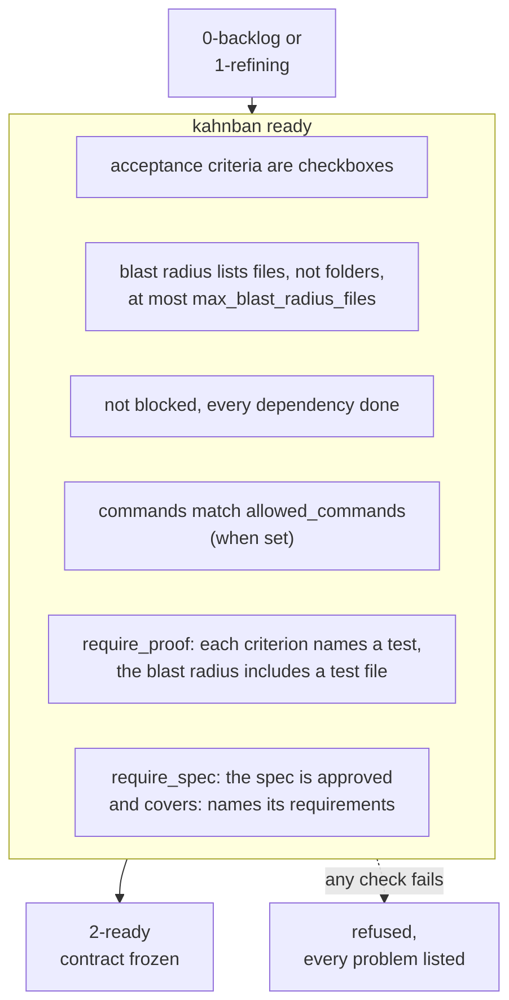
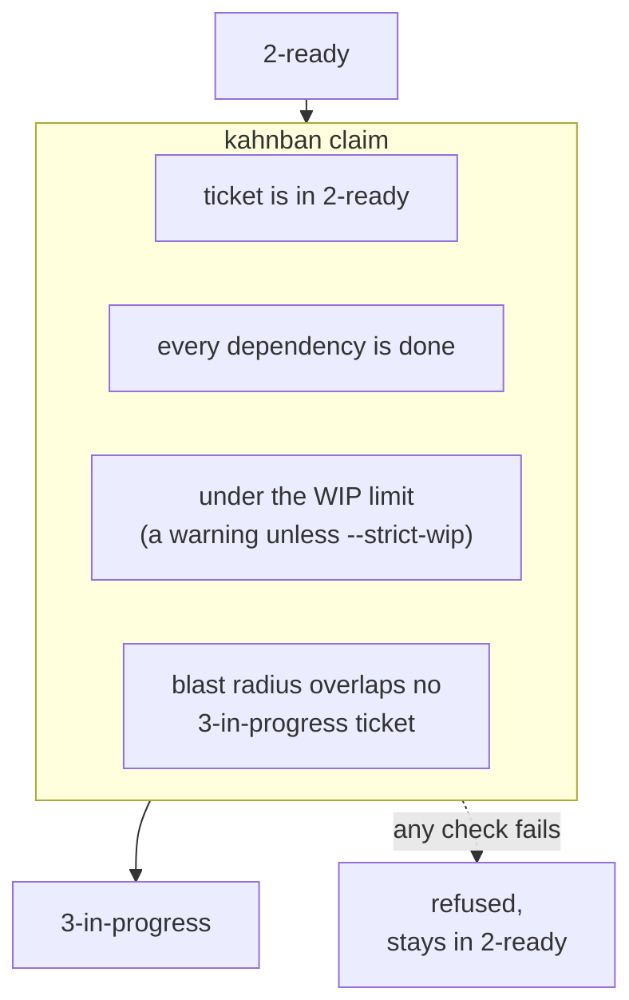
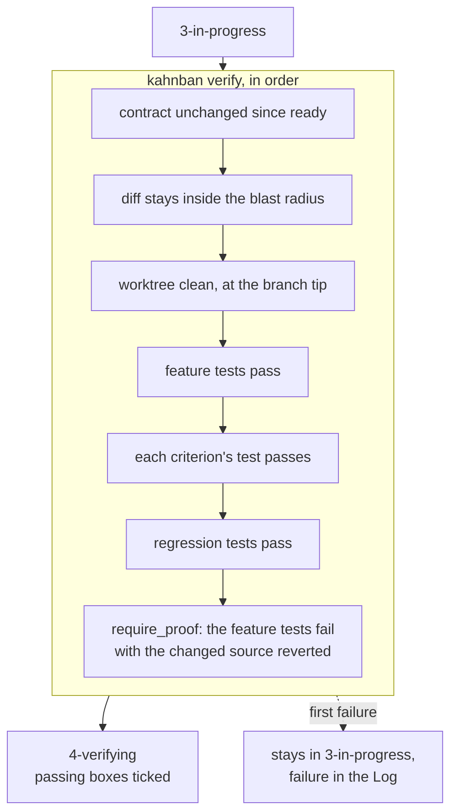
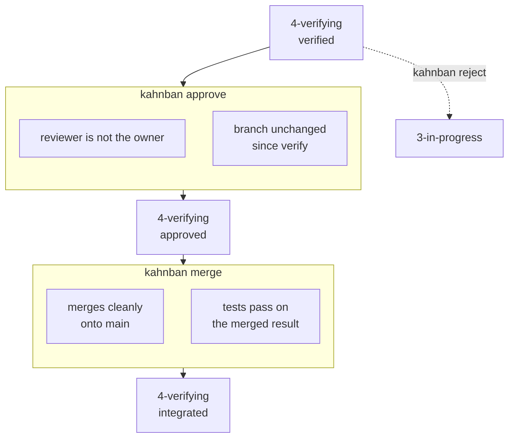
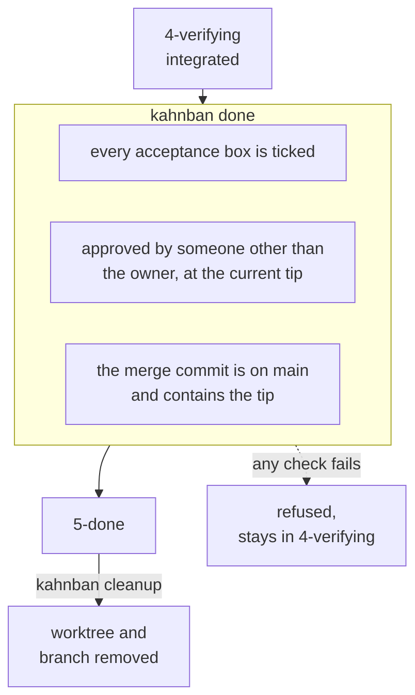
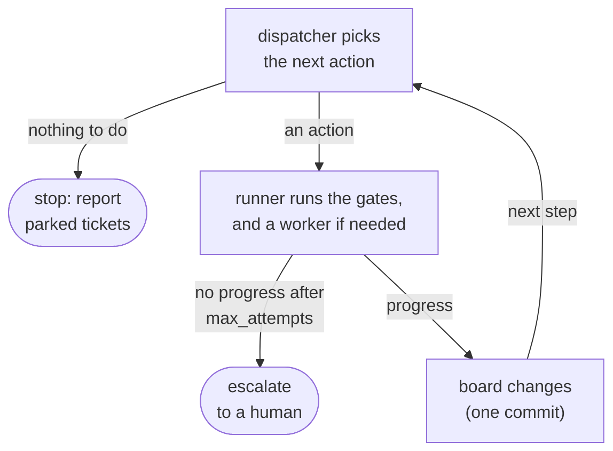
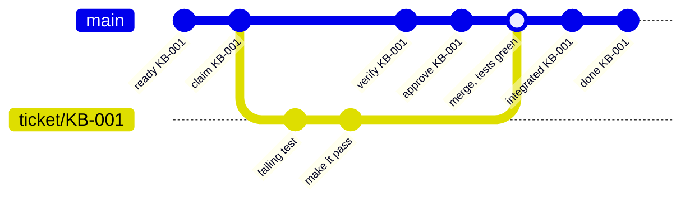
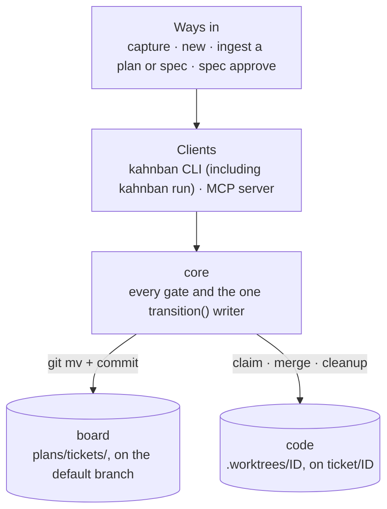
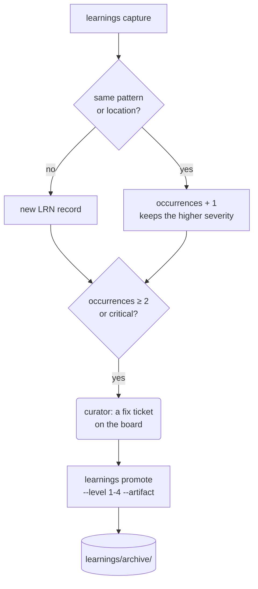

# How Kahnban Works

This page is one level down from the [board overview in the README](../README.md#how-it-works). It goes stage by stage through what happens in each column and what the gate out of it checks, then covers the deeper flows: the factory loop, the merge queue, the architecture and the learnings loop.

- [Stage by stage](#stage-by-stage): [backlog and refining](#backlog-and-refining), [ready](#ready), [in progress](#in-progress), [verifying](#verifying), [done](#done)
- [Deeper flows](#deeper-flows): [the factory loop](#the-factory-loop), [the merge queue](#the-merge-queue), [architecture](#architecture), [the learnings loop](#the-learnings-loop)

## Stage by stage

Every gate is one function in `core`, and the CLI, the MCP server and `kahnban run` all call that same function. When a check fails, the ticket stays where it is and the command says why. The diagrams show the checks; the [gate tables in the README](../README.md#what-verify-refuses) have the exact refusal rules.

### Backlog and refining

**Who:** a human, or the spec-analyst worker under `kahnban run`.

`capture`, `new` and `ingest` create tickets in `0-backlog`. Refining turns a ticket into a contract: acceptance criteria that each name the test that proves them, a blast radius listing the files the change may touch, and the feature and regression commands under `## Validation`. `ingest --ready` moves fresh tickets to `1-refining` and tries the gate straight away; `ready` also accepts a ticket that is still in `0-backlog`.

The ready gate checks everything and lists every problem at once:

Passing freezes the contract: a hash of the acceptance criteria, blast radius and validation sections, which `verify` checks later. In a repo with `.agents/` (from `init --agentic`) it also writes a handoff baton and fires the `post-ready` hook.

### Ready

**Who:** nobody yet. The ticket waits for a coder.

A ticket stays in `2-ready` until someone claims it, and it can only be claimed while no in-progress ticket touches the same files. That rule is what keeps parallel agents out of each other's way. Claim stops at the first check that fails:

Passing records a lease for the owner. With `--worktree` (which `kahnban run` always uses) it creates the worktree `.worktrees/<ID>` on branch `ticket/<ID>` and writes `.agents/HANDOFF.json` into it. In a repo with `.agents/` it also fires the `post-claim` hook.

### In progress

**Who:** the coder.

The coder works test-first inside the worktree and commits on `ticket/<ID>`. Board files never change on that branch. Verify tests the committed tip and runs its checks in order, stopping at the first failure:

A pass ticks the box of every criterion whose test passed, records the verified tip, clears any earlier approval and fires the `post-verify` hook. A failure is committed to the ticket's `## Log` with the output, so the next attempt can see what broke.

### Verifying

**Who:** the qa-reviewer, then the integrator.

The ticket stays in `4-verifying` through two gates. Only its records change: first an approval, then an integration commit.

A reviewer who finds a problem runs `reject` instead of `approve`. That sends the ticket back to `3-in-progress`, unticks every box, clears the verify, approval and integration records, and puts the reasons in the Log for the coder. A refused merge lands nothing; under `kahnban run` it is rejected back automatically. [The merge queue](#the-merge-queue) shows what `merge` does in git.

### Done

**Who:** the integrator (the runner, under `kahnban run`).

`done` collects every problem before it refuses:

The approval and merge checks apply under `require_review` and `require_integration`, which `kahnban init` turns on. Passing fires the `post-done` hook, which prompts a learnings reflection. `cleanup` then removes the worktree and the local ticket branch.

## Deeper flows

### The factory loop

`kahnban run` drives the board without a human in the loop. Each step it asks the dispatcher for the most urgent action, runs the gates itself, and starts an agent worker only for judgment work. When the action moves the board, the loop asks again:

The dispatcher takes the first row that matches, so finishing work comes before starting new work:

| # | When the board has | The runner | Worker |
| :--- | :--- | :--- | :--- |
| 1 | an approved ticket in `4-verifying` | runs merge, done and cleanup; a refused merge is rejected back | — |
| 1 | an unapproved ticket in `4-verifying` | starts a review, which approves or rejects | qa-reviewer |
| 2 | a `3-in-progress` ticket with no live lease | resumes it (or revises it after a rejection), then runs verify | coder |
| 3 | a learning seen twice or marked critical (once per run) | starts a curator, which files a fix ticket and promotes the learning | curator |
| 4 | a `2-ready` ticket whose blast radius is free | claims it into a worktree, then implements and verifies it | coder |
| 5 | a ticket in `0-backlog` or `1-refining` | starts refinement, then runs the ready gate | spec-analyst |

Escalating sets `blocked_on: human: <reason>` and fires the `on-escalate` hook; the dispatcher skips the ticket until someone runs `kahnban unblock`. Workers run with `KAHNBAN_ROLE` set, so [`kahnban guard`](../README.md#running-the-factory-kahnban-run) and the CLI refuse anything outside their role.

### The merge queue

The board and the code meet only here. `merge` merges the ticket branch onto the default branch in a scratch worktree, runs the feature and regression tests on that result, and fast-forwards the default branch only if they pass. It holds the board lock while the tests run, so each merge is tested against everything merged before it:

### Architecture

Every way in reaches the same core, and the core is the only code that moves a ticket:

Agent workers go through the same clients as a human, with `KAHNBAN_ROLE` set. `spec approve` is blocked for every factory role: only a human approves intent.

### The learnings loop

Mistakes and friction are captured into `./learnings/`, where repeats cluster into one record instead of piling up. A record that recurs gets a structural fix:

The four promotion levels, from architecture down to documentation, are described in the [README](../README.md#continuous-learning-subsystem-learnings).
